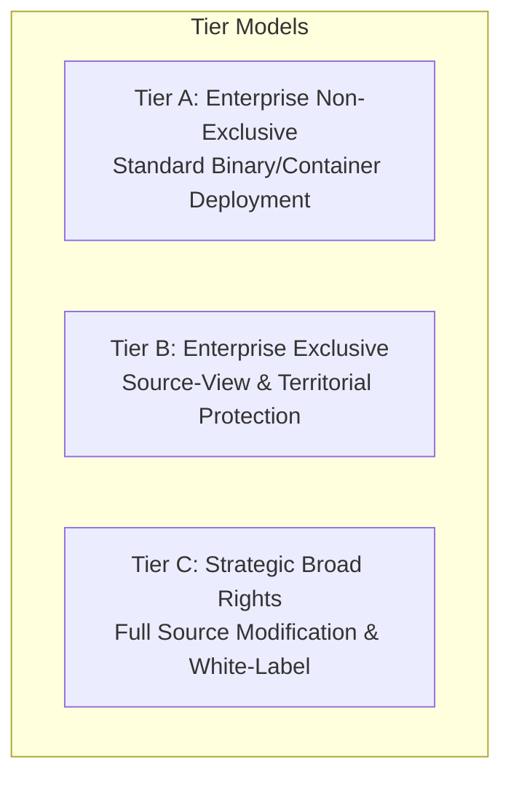

# SpiceGarden v1.0.0-rc1 — Commercial Licence Tiers & Rights Matrix

**Document Name:** Commercial Licence Tiers & Rights Matrix  
**Version:** `1.0.0`  
**Date:** 2026-09-30  
**Status:** `INTERNAL REVIEW`  
**Owner:** Commercialization & Licensing Lead  
**Document Classification:** `INDICATIVE NEGOTIATION FRAMEWORK — NOT EXECUTED COMMERCIAL TERMS`  

> [!NOTE]
> All financial figures and terms set forth herein represent indicative commercial negotiation baselines and starting points. They do not constitute an executed contract, binding price list, or public tariff. Actual commercial terms remain subject to negotiation, due diligence, territorial scoping, and bilateral execution.

---

## 1. Commercial Licence Tier Summary

---

## 2. Detailed Tier Specifications

### Tier A: Enterprise Non-Exclusive
* **Target Profile:** Single-region food delivery operators, regional restaurant chains, hyper-local courier businesses wanting a proven, turn-key software platform.
* **Indicative Commercial Structure:**
  - **Initial Licence Fee:** **₹75 Lakh (INR 7.5 Million)** upfront.
  - **Annual Support & Maintenance:** **₹15 Lakh/year (INR 1.5 Million/year)**.
* **Delivery Form:** Pre-compiled production container images (`spicegarden-backend:v1.0.0-rc1`), Next.js standalone build artifacts, mobile binary bundles (AAB/IPA).
* **Licence Grant:** Non-exclusive, non-transferable, single-territory internal operational use.
* **Source-Code Access:** None (Containerized / Binary delivery only; optional 3rd-party escrow trigger package available).

---

### Tier B: Enterprise Exclusive (Territory / Vertical Carve-Out)
* **Target Profile:** Major national operators, dominant regional marketplaces, or specialized dark-kitchen chains requiring territorial or industry exclusivity to protect their competitive advantage.
* **Indicative Commercial Structure:**
  - **Initial Licence Fee:** **₹1.25 Crore to ₹2.00 Crore (INR 12.5M – 20.0M)** upfront depending on territory size and exclusivity duration.
  - **Annual Support & Maintenance:** **₹20 Lakh to ₹35 Lakh/year (INR 2.0M – 3.5M/year)**.
* **Exclusivity Boundaries (Strictly Defined):**
  - *Territory:* Defined geographic boundary (e.g., specific states or designated country).
  - *Field of Use / Vertical:* Defined segment (e.g., Quick-Commerce grocery vs Prepared restaurant food).
  - *Duration:* Fixed term (e.g., 2 to 3 years) with minimum performance/renewal thresholds.
* **Source-Code Access:** Read-only / source-view rights for internal security audits, with source escrow included.

---

### Tier C: Strategic / Broad Rights Licence
* **Target Profile:** Conglomerates, enterprise software aggregators, or strategic technology buyers seeking comprehensive operational autonomy, white-label re-branding, custom module development, and full source code modification rights.
* **Indicative Commercial Structure:**
  - **Initial Licence Fee:** **₹2.00 Crore to ₹3.00 Crore+ (INR 20.0M – 30.0M+)** depending on specific rights surrendered and custom transition scope.
  - **Annual Support / Advisory:** Custom Tier 1 Enterprise SLA or independent internal engineering handover.
* **Important Legal Note:** Tier C is a **Broad Enterprise Source-Code Licence**, NOT an outright copyright assignment or IP sale, unless an explicit separate Intellectual Property Assignment Deed is drafted and executed.
* **Source-Code Access:** Full repository source code access across all 12 monorepo workspaces, internal fork modification rights, and white-label branding rights.

---

## 3. Comprehensive Commercial Rights Matrix

| Rights Category | Tier A (Non-Exclusive) | Tier B (Exclusive) | Tier C (Strategic Broad) |
| :--- | :--- | :--- | :--- |
| **Deployment Model** | 1 Prod + 1 Staging + 1 DR | Up to 3 Prod Clusters | Unlimited Internal Clusters |
| **Delivery Format** | Pre-built Containers & Binaries | Containers + Escrow Access | Full Source Code Monorepo |
| **Source-Code Access** | None | Source-View Audit / Escrow | Full Read/Write Internal Access |
| **Code Modification** | None (Config / API only) | Minor configuration patches | Full Internal Modifications |
| **Derivative Works** | Prohibited | Prohibited | Permitted for Internal Use |
| **Territory Scope** | Single Defined Territory | Exclusive Defined Territory | Multi-Territory / Global Internal |
| **Commercial Exclusivity** | Non-Exclusive | **Exclusive** (by geography/vertical) | Non-Exclusive (Broad Rights) |
| **White-Labeling / Re-Branding** | Prohibited (Standard UI) | Permitted in Territory | Fully Permitted |
| **Sublicensing to 3rd Parties** | Prohibited | Prohibited | Prohibited (Internal Only) |
| **Resale Rights** | Prohibited | Prohibited | Prohibited |
| **Hosting Environment** | Customer Dedicated Cloud | Customer Dedicated Cloud | Any Infrastructure |
| **Support SLA** | Standard Business Hours (P1-P4) | Priority 24/7 (P1-P4) | Dedicated Lead Engineer Tier |
| **Version Upgrades** | Minor patches (v1.0.x) | Minor patches + Minor releases | Full access to release branch |
| **Source Escrow Included** | Add-on (Optional fee) | **Included** | **Full Direct Repository Access** |
