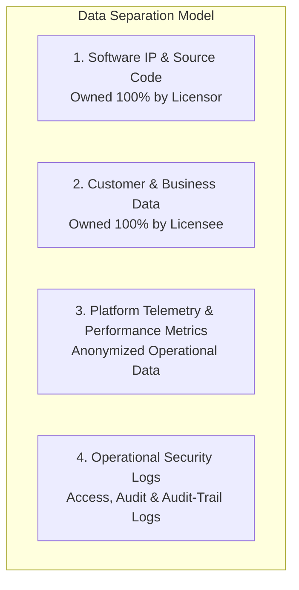

# SpiceGarden v1.0.0-rc1 — Data Processing & Privacy Schedule

**Document Name:** Data Processing & Privacy Schedule (Schedule E)  
**Version:** `1.0.0`  
**Date:** 2026-09-30  
**Status:** `INTERNAL REVIEW / LEGAL REVIEW REQUIRED`  
**Owner:** Data Protection & Security Lead  
**Regulatory Alignment:** Digital Personal Data Protection Act, 2023 (India) | Information Technology Act, 2000 | GDPR (where applicable)  
**Document Classification:** `DATA PROCESSING AGREEMENT (DPA) SCHEDULE`  

> [!WARNING]
> **LEGAL COUNSEL REVIEW REQUIRED**: Specific statutory provisions herein must be reviewed by qualified privacy counsel in the respective operational jurisdictions of the Parties.

---

## 1. Classification & Separation of Data Assets

To ensure absolute clarity regarding intellectual property and data ownership, all digital assets within the SpiceGarden ecosystem are categorized into four distinct tiers:

| Data Category | Definition / Scope | Legal Ownership | Access & Usage Rights |
| :--- | :--- | :--- | :--- |
| **1. Software IP** | Source code, algorithms, schemas, architecture, documentation. | **Licensor** | Licensed to Licensee solely for internal operations. |
| **2. Customer Data** | End-consumer PII, phone numbers, delivery addresses, order histories, payment tokens, merchant pricing, driver financial records. | **Licensee (Sole Owner)** | Licensee has exclusive ownership. Licensor has ZERO ownership and zero rights to commercialize. |
| **3. Platform Telemetry** | Aggregate API latency, error counts, memory usage, CPU metrics, event loop delays. | **Shared / Anonymized** | Used by Licensor solely for bug diagnostics and platform performance tuning. |
| **4. Operational Logs** | Web server access logs, authentication attempt logs, DB audit trails. | **Licensee** | Retained for compliance, fraud prevention, and audit security. |

---

## 2. Roles of the Parties under Privacy Regulations

* **Under Indian Law (DPDPA 2023):**
  - **Licensee** acts as the **"Data Fiduciary"** (determining purpose and means of processing).
  - **Licensor** (when providing hosted services or support assistance) acts solely as a **"Data Processor"** acting on documented instructions from the Data Fiduciary.
* **Under European Law (GDPR — where applicable):**
  - **Licensee** acts as the **"Data Controller"**.
  - **Licensor** acts as the **"Data Processor"**.

---

## 3. Security Standards & Controls

1. **Encryption Standards:**
   - *In Transit:* Mandatory TLS 1.3 encryption across all client web, mobile, and API communications.
   - *At Rest:* AES-256 encryption applied to PostgreSQL storage volumes, MongoDB logs, and Redis persistence snapshots.
2. **Password Security:** Argon2id password hashing (`memoryCost: 19456`, `timeCost: 2`, `parallelism: 1`) bounded by hardware concurrency limiters.
3. **Role-Based Access Control (RBAC):** Strict least-privilege access enforcement separating customer, merchant, driver, and super-admin personas.
4. **Token Security:** Short-lived JWT access tokens (15m expiration) paired with cryptographically secure, rotating refresh tokens stored in HTTP-Only, Secure, `SameSite=Strict` cookies.

---

## 4. Data Retention, Deletion, and Backups

* **Retention Schedules:** Configurable by Licensee within administrative governance settings.
* **Right to be Forgotten (Erasure):** SpiceGarden backend includes automated PII anonymization routines allowing complete scrubbing of customer personal data upon consumer request while preserving necessary double-entry financial ledger parity.
* **Backup Lifecycle:** Automated daily snapshots retained in Licensee-controlled encrypted object storage; automated pruning after 30 days.

---

## 5. Security Incident & Breach Notification

* **Incident Escalation:** In the event of a confirmed security incident impacting customer personal data:
  - The processor shall notify the Data Fiduciary within **twenty-four (24) hours** of confirmation.
  - The notification shall include the nature of the breach, categories of data affected, estimated records impacted, and immediate remediation steps taken.

---

## 6. Subprocessors and Cross-Border Transfers

* **Subprocessor Authorization:** Licensor shall not engage third-party subprocessors with access to Licensee Customer Data without prior written authorization.
* **Cross-Border Compliance:** Licensee retains complete control over cloud deployment regions to satisfy domestic data localization mandates under applicable law.
