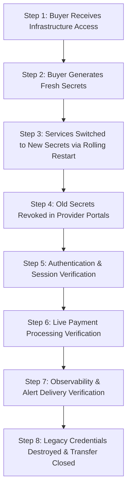

# SpiceGarden v1.0.0-rc1 — Infrastructure Transfer & Secret Rotation Runbook

**Release**: `v1.0.0-rc1`  
**Git Baseline**: `ca349e510d3c18a7517da7502f70ef15bd37fe77`  
**Classification**: **`INFRASTRUCTURE CONFIGURATION VERIFIED — RECIPIENT TRANSFER PENDING`**  
**Audience**: Lead SRE, Cloud Architects, and Systems Administrators  

---

## 1. System Inventory & Transfer Matrix

For each core subsystem, the transfer actions, dependencies, validation criteria, and rollback steps are documented below:

| System Subsystem | Current Owner | Transfer Action | Recipient Owner | Dependencies | Validation Step | Rollback Step |
| :--- | :--- | :--- | :--- | :--- | :--- | :--- |
| **Domain Names (`spicegarden.app`, `.io`, `.dev`)** | Seller Registrar Account | Unlock domain, obtain EPP/Auth code, initiate registrar transfer. | Buyer Registrar Account | None | WHOIS lookup shows Buyer organization as registrant. | Cancel transfer in registrar portal prior to auth code submission. |
| **Authoritative DNS Zone** | Seller DNS (Cloudflare/Route53) | Export zone records, import into Buyer DNS nameservers, update NS records. | Buyer DNS Team | Domain Transfer | `dig NS spicegarden.app` returns Buyer nameservers. | Re-point NS records to Seller nameservers. |
| **TLS Certificates (Let's Encrypt / Cert-Manager)** | Seller Cluster Issuer | Deploy `cert-manager` in Buyer cluster with ACME HTTP-01/DNS-01 solver. | Buyer SRE Team | DNS Zone Active | `openssl s_client -connect spicegarden.app:443` validates TLS SANs. | Use backup wild-card certificate secret. |
| **Cloud Tenant (AWS / GCP / Azure)** | Seller Cloud Organization | Buyer creates new organization tenant; Terraform/K8s manifests applied. | Buyer Cloud Ops | Cloud Billing Account | `kubectl get nodes -o wide` confirms Buyer cluster online. | Tear down newly provisioned Buyer tenant resources. |
| **Kubernetes Cluster (1.29+)** | Seller Infrastructure | Apply `infra/k8s/production-hardened.yaml` and configure HPA (min 3, max 20). | Buyer SRE Team | Cloud Tenant | All pods in `Running` state; HPA metrics active. | `kubectl delete -f infra/k8s/production-hardened.yaml` |
| **Container Registry (GHCR / ECR)** | Seller Registry | Build and push tagged images (`v1.0.0-rc1`) to Buyer private registry. | Buyer Release Team | CI/CD Pipeline | `docker pull <buyer-registry>/spicegarden-backend:v1.0.0-rc1` succeeds. | Repoint image pull secrets to Seller registry. |
| **Object Storage (S3 / GCS)** | Seller Bucket | Create Buyer bucket; sync menu media and document assets using `aws s3 sync`. | Buyer Storage Admin | Cloud Tenant | Verify asset HTTP 200 URLs (`/static/images/...`). | Re-enable read-only access to Seller bucket. |
| **PostgreSQL 16 HA + PgBouncer** | Seller Database Instance | Take physical snapshot; restore to Buyer RDS/CloudNativePG; run TypeORM migrations. | Buyer DBA Team | Cloud Tenant, VPC | Connect via PgBouncer (pool 100); verify 47,910 balanced ledger rows. | Revert DB connection string to Seller database. |
| **Redis 7.2 Cluster** | Seller Redis Instance | Provision Buyer Redis cluster; configure auth password and cluster connection string. | Buyer SRE Team | VPC Peering | `redis-cli PING` returns `PONG`; rate-limiter keys populate. | Repoint backend `REDIS_HOST` to Seller Redis. |
| **Monitoring (Prometheus / Grafana)** | Seller Observability Stack | Deploy Prometheus helm chart; import dashboards from `infra/monitoring/dashboards`. | Buyer Ops Team | K8s Cluster | Grafana UI loads metrics at `http://grafana.<domain>`. | Retain Seller Grafana instance during migration. |
| **Logging (OpenSearch / Fluentbit)** | Seller OpenSearch Stack | Provision Buyer OpenSearch instance; deploy daemonset log collectors. | Buyer Ops Team | K8s Cluster | OpenSearch Dashboards display live structured JSON logs. | Retain Seller log cluster. |
| **Automated Backups** | Seller CronJob | Configure S3/GCS backup bucket in `infra/scripts/backup.sh`; schedule cron. | Buyer Ops Team | Object Storage | Execute test backup; confirm archive written to Buyer bucket. | Manually retain last verified Seller snapshot. |
| **Email Gateway (SendGrid / AWS SES)** | Seller Provider Account | Buyer provisions SendGrid/SES; configures SPF/DKIM/DMARC in DNS. | Buyer App Admin | DNS Active | Send test transactional email; check SPF/DKIM pass. | Fall back to Seller SendGrid API key temporarily. |
| **SMS Gateway (Twilio / MessageBird)** | Seller Provider Account | Buyer provisions Twilio SID & Auth Token; configures webhook callbacks. | Buyer App Admin | Provider Account | Execute test customer OTP verification SMS. | Fall back to Seller Twilio credentials. |
| **Push Gateway (FCM / APNs)** | Seller Developer Portals | Buyer uploads APNs `.p8` key and FCM service account JSON to K8s secrets. | Buyer Mobile Team | App Store Accounts | Send test push notification to registered test device. | Revert push keys in Kubernetes secret. |
| **Mapping Services (Google Maps API)** | Seller Google Cloud Console | Buyer creates Google Cloud project, enables Places/Geocoding/Directions, restricts keys. | Buyer App Admin | Cloud Billing | Backend distance matrix and frontend route maps load. | Retain Seller Google Maps API key temporarily. |
| **Payment Gateways (Stripe / Razorpay)** | Seller Merchant Accounts | Buyer sets live keys in K8s secrets; updates webhook endpoints in dashboards. | Buyer Finance Team | Bank Account Verification | Process live $1.00 charge and verify webhook receipt. | Re-enable sandbox test mode. |

---

## 2. Eight-Step Secret Rotation Execution Sequence

To execute a seamless, zero-downtime credential transfer:



### Step 1: Buyer Receives Infrastructure Access
- Buyer SRE team receives root/administrator access to the target cloud VPC, Kubernetes cluster, and secrets management engine (HashiCorp Vault, AWS Secrets Manager, or Kubernetes SealedSecrets).

### Step 2: Buyer Generates Fresh Secrets
- Buyer creates cryptographically random strings (min 64 chars) for all internal systems and obtains live API keys for third-party services:
  - `JWT_SECRET`
  - `ENCRYPTION_SECRET`
  - `DB_PASS`
  - `REDIS_PASS`
  - `STRIPE_SECRET_KEY` & `STRIPE_WEBHOOK_SECRET`
  - `RAZORPAY_KEY_ID`, `RAZORPAY_KEY_SECRET` & `RAZORPAY_WEBHOOK_SECRET`
  - `SENDGRID_API_KEY`
  - `TWILIO_ACCOUNT_SID` & `TWILIO_AUTH_TOKEN`
  - `GOOGLE_MAPS_API_KEY`
  - `GRAFANA_ADMIN_PASSWORD`

### Step 3: Rolling Deployment with New Secrets
- Update the Kubernetes Secret manifests:
  ```bash
  kubectl apply -f infra/k8s/secrets/production-secrets.yaml
  ```
- Trigger a rolling restart of the API deployment to load new environment variables:
  ```bash
  kubectl rollout restart deployment/spicegarden-backend -n production
  kubectl rollout status deployment/spicegarden-backend -n production
  ```

### Step 4: Revocation of Legacy Credentials
- Seller immediately revokes old API keys and rotates passwords in all legacy accounts.

### Step 5: Authentication & User Session Verification
- Execute smoke test against `/auth/login` and `/auth/signup`.
- Confirm `CryptoConcurrencyLimiter` and Argon2 password verification succeed under the new `JWT_SECRET`.

### Step 6: Payment & Webhook Verification
- Process a test transaction using the Buyer Stripe/Razorpay accounts.
- Confirm webhook signature validation passes with `STRIPE_WEBHOOK_SECRET`.

### Step 7: Observability & Alert Delivery Verification
- Trigger a synthetic high-latency test to verify Prometheus alert firing and PagerDuty/Slack routing.

### Step 8: Legacy Credential Destruction
- Both parties execute secure deletion of transitional credential files.
- Sign the Transfer Completion Certificate.
