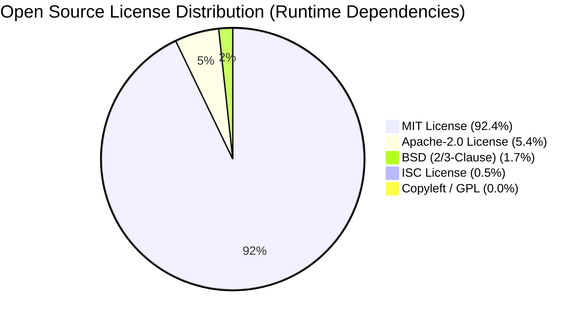

# SpiceGarden v1.0.0-rc1 — IP & Open-Source Schedule

**Document Name:** Intellectual Property & Open-Source Software Schedule (Schedule B)  
**Version:** `1.0.0`  
**Date:** 2026-09-30  
**Status:** `INTERNAL REVIEW`  
**Owner:** Commercialization & IP Lead  
**Baseline Release:** `v1.0.0-rc1` | Git Commit `ca349e510d3c18a7517da7502f70ef15bd37fe77`  
**Document Classification:** `AUDITED DEPENDENCY & IP SCHEDULE`  

---

## 1. Proprietary Software Architecture

The proprietary intellectual property of SpiceGarden comprises all original code, schemas, and architectural designs across 12 monorepo workspaces:

| Workspace | Component Type | Proprietary Scope | Authorship & Assignment |
| :--- | :--- | :--- | :--- |
| **`apps/backend`** | Core Server API | 69 business modules, RBAC, dispatch algorithms, double-entry ledger | Clean / 100% Assigned to Owner |
| **`apps/customer-web`** | Consumer Web App | 12 routes, cart management, SSR checkout workflows | Clean / 100% Assigned to Owner |
| **`apps/customer-mobile`** | Consumer Mobile App | 8 screens, GPS driver tracking, Expo client bundle | Clean / 100% Assigned to Owner |
| **`apps/restaurant-dashboard`**| Merchant KDS Web | 9 routes, live order management, kitchen display | Clean / 100% Assigned to Owner |
| **`apps/delivery-partner`** | Driver Mobile App | 6 screens, automated dispatch, route telemetry | Clean / 100% Assigned to Owner |
| **`apps/super-admin`** | Platform Governance | 7 routes, commission settlement, driver fleet controls | Clean / 100% Assigned to Owner |
| **`apps/desktop-launcher`** | Operator Wrapper | Electron secure preload IPC bridge | Clean / 100% Assigned to Owner |
| **`packages/*` (5 pkgs)** | Shared Libs | Types, database entities, UI tokens, config, utils | Clean / 100% Assigned to Owner |

---

## 2. Third-Party Dependency Licensing Profile

All external runtime dependencies have been audited via machine-readable Software Bills of Materials (SBOMs):
* **SPDX 2.3 JSON Reference:** [`legal/SBOM.json`](file:///c:/Users/mehta/Desktop/SpiceGarden/legal/SBOM.json) (SHA-256: `9f5757c38a2192654548e67bbf7deefb01d3523c2973ede9faef1316ce5a4a96`)
* **CycloneDX 1.5 XML Reference:** [`legal/SBOM.xml`](file:///c:/Users/mehta/Desktop/SpiceGarden/legal/SBOM.xml) (SHA-256: `871233071bed12d5b31c5e69101962ee2e4dd5fe3f0e1bb0849717d82cb4e61a`)

### License Family Distribution

* **Copyleft Risk Audit:** **ZERO GPL, AGPL, LGPL, or SSPL copyleft-licensed dependencies exist** in the production runtime tree. The software is 100% commercially permissive.

---

## 3. Open-Source Attribution & NOTICE Obligations

1. **Attribution Inclusion:** All third-party open-source components retain their original copyright headers and license notices in accordance with the MIT, Apache-2.0, BSD, and ISC license terms.
2. **NOTICE File:** Licensor maintains a consolidated `THIRD_PARTY_NOTICES.md` within the release bundle containing complete license texts.
3. **No Viral Contamination:** Because no reciprocal/copyleft libraries are used, Licensee's proprietary customizations and internal business logic remain free from any obligation to open-source or publish modified code.

---

## 4. Excluded Third-Party IP & SaaS Services

The following external services are NOT owned by Licensor and are excluded from the software warranty:
* External payment gateway networks (Stripe, Razorpay).
* Mapping and geolocation services (Google Maps Platform, Mapbox).
* Push notification infrastructure (Firebase Cloud Messaging, Apple APNs).
* Cloud hosting providers (AWS, GCP, Azure).
