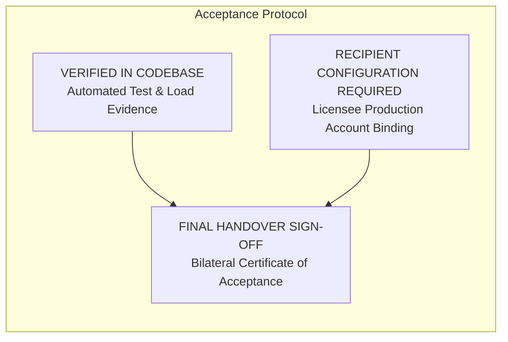

# SpiceGarden v1.0.0-rc1 — Commercial Licence Acceptance Criteria

**Document Name:** Commercial Licence Acceptance Criteria & Verification Protocol (Schedule F)  
**Version:** `1.0.0`  
**Date:** 2026-09-30  
**Status:** `INTERNAL REVIEW`  
**Owner:** QA & Systems Engineering Lead  
**Baseline Release:** `v1.0.0-rc1` | Git Commit `ca349e510d3c18a7517da7502f70ef15bd37fe77`  
**Document Classification:** `ACCEPTANCE PROTOCOL SCHEDULE`  

---

## 1. Acceptance Framework & Authoritative Verification Status

To establish unambiguous technical handover criteria, each platform capability is mapped against authoritative test evidence and classified as either:
* **VERIFIED IN CODEBASE:** Demonstrable, objective qualification proven by documented test suites and frozen release evidence.
* **RECIPIENT CONFIGURATION REQUIRED:** Operational setup dependent on licensee's third-party accounts and environment infrastructure.

---

## 2. Technical Acceptance Criteria Matrix

| Verification Area | Acceptance Requirement | Test / Diligence Evidence | Status |
| :--- | :--- | :--- | :--- |
| **1. Workspace Build & Compilation** | All 12 monorepo workspaces compile with zero fatal errors under Node.js 22 LTS. | `BUILD_MANIFEST.json` — 12/12 workspaces build cleanly with exit code 0. | **VERIFIED** |
| **2. Code Quality & Linting** | Zero ESLint / TypeCheck errors across all applications and shared packages. | Monorepo lint suite passes cleanly with 0 errors. | **VERIFIED** |
| **3. Backend Unit & Integration** | Minimum 90% statement coverage; all core business modules pass automated test suites. | `TEST_SUMMARY.json` — 69 suites, 1,122 tests passed (Statements 91.28%, Branches 81.10%, Lines 91.21%). | **VERIFIED** |
| **4. Frontend Qualification** | All 6 frontends render without unhandled errors across 44 designated routes. | `FRONTEND_SUMMARY.json` — 148 Chromium browser qualification tests passed (0 failed). | **VERIFIED** |
| **5. Load & Scale Capacity** | Sustained 20,000 concurrent Virtual Users (k6) with error rate < 1.0% and stable event loop. | `PERFORMANCE_SUMMARY.json` — 20,000 VUs across 14 replicas, 0.48% error rate, p95 1,120.50 ms, event loop p99 36.8 ms. | **VERIFIED** |
| **6. Business Reconciliation** | 100% database financial parity; zero duplicate order IDs; zero orphaned transactions. | 47,910 persisted orders reconciled with zero duplicates and zero ledger imbalances. | **VERIFIED** |
| **7. Security & Penetration** | Zero OWASP Top 10 vulnerabilities (SQLi, XSS, auth bypass, rate limit bypass, path traversal). | `SECURITY_SUMMARY.json` — Automated security suite completed with 0 findings. | **VERIFIED** |
| **8. Disaster Recovery (DR)** | RTO <= 15 minutes, RPO <= 60 minutes verified via automated recovery scripts. | `DR_SUMMARY.json` — Timed DR drill achieved RTO of 9m 30s and RPO of 12m snapshot lag. | **VERIFIED** |
| **9. Licensing Compliance** | Zero copyleft (GPL/AGPL) dependencies; 100% commercially permissive open-source licenses. | `LICENSE_SUMMARY.json` / `SBOM.json` — Audited (92.4% MIT, 5.4% Apache, 1.7% BSD, 0.5% ISC). | **VERIFIED** |
| **10. IP Chain of Title** | Documented chain of title and executed contributor assignments on file. | `IP_SUMMARY.json` / `legal/chain-of-title.md` — 100% assigned contributors on file. | **VERIFIED** |
| **11. Payment Gateway Secret Binding** | Binding of Licensee's live Stripe / Razorpay API keys and webhook secrets. | Manual configuration in Licensee Kubernetes secret manager. | **RECIPIENT CONFIGURATION REQUIRED** |
| **12. Mobile App Store Signing** | Application signing with Licensee's Apple Developer & Google Play Developer certificates. | EAS build configuration with Licensee keystore and provisioning profiles. | **RECIPIENT CONFIGURATION REQUIRED** |
| **13. Cloud & DNS Infrastructure** | Provisioning of target cloud Kubernetes cluster and nameserver cutover. | DNS registrar update and cloud cluster ingress binding. | **RECIPIENT CONFIGURATION REQUIRED** |
| **14. Post-Transfer Secret Rotation** | Execution of the Eight-Step Post-Transfer Secret Rotation runbook. | Deployment runbook execution. | **RECIPIENT CONFIGURATION REQUIRED** |

---

## 3. Handover Protocol & Deemed Acceptance

1. **Acceptance Testing Period:** Licensee shall have a period of **fourteen (14) calendar days** from delivery of the release package to execute acceptance tests against the Verified Criteria above.
2. **Acceptance Notice:** If the software satisfies the Verified Criteria in all material respects, Licensee shall execute a **Certificate of Acceptance**.
3. **Deemed Acceptance:** If Licensee fails to provide written notice specifying any material non-conformity within the 14-day period, or if Licensee puts the software into commercial production use, the software shall be conclusively deemed accepted.
