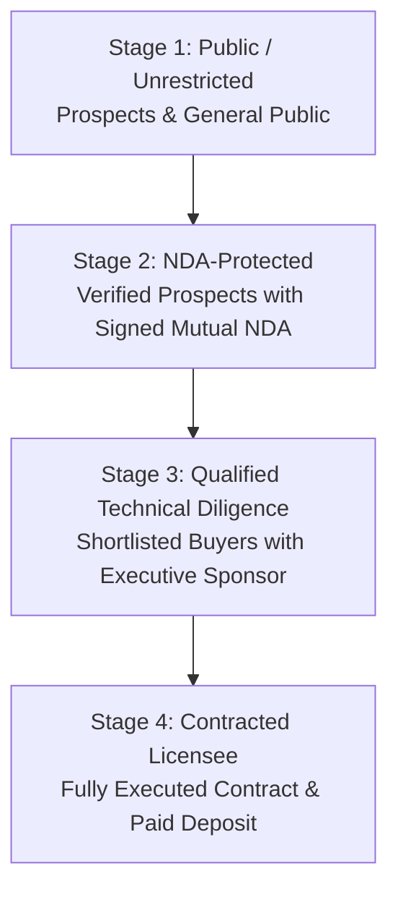

# SpiceGarden v1.0.0-rc1 — Staged Diligence Data Room Access Model

**Document Name:** Staged Diligence Data Room Access Model  
**Version:** `1.0.0`  
**Date:** 2026-09-30  
**Status:** `INTERNAL REVIEW`  
**Owner:** Commercialization & Security Lead  
**Document Classification:** `SECURITY & ACCESS GOVERNANCE PROTOCOL`  

---

## 1. Information Disclosure Governance

To protect proprietary intellectual property, trade secrets, and system integrity, access to the SpiceGarden diligence assets is governed by a **4-Stage Progressive Disclosure Model**:

---

## 2. Staged Access Boundaries and Document Mapping

| Access Stage | Eligibility & Prerequisites | Accessible Data Room Sections | Disclosed Material & Artifacts | Restrictions |
| :--- | :--- | :--- | :--- | :--- |
| **Stage 1: Public** | Open to prospective buyers and website visitors. | `01_Product` | Product overview, functional feature lists, high-level architectural diagram, user journey screenshots. | Zero technical specifics, zero pricing, zero test logs. |
| **Stage 2: NDA-Protected** | Verified enterprise prospects with executed Mutual NDA. | `03_Architecture`, `04_Performance`, `05_Security`, `17_Commercial`, `19_Commercial-Licensing` | Detailed component architecture, executive performance summaries (20k VU benchmark), security test summaries, commercial licence tiers, indicative pricing, and Support SLA schedules. | No raw source code, no database schemas, no detailed IP assignment files. |
| **Stage 3: Qualified Diligence** | Active buyers undergoing formal technical & legal audit. | `02_Source`, `06_Database`, `07_Infrastructure`, `10_Disaster-Recovery`, `11_IP-Ownership`, `12_Licensing`, `14_Test-Evidence`, `16_Legal` | Monorepo layout and workspace structure, PostgreSQL entity schemas, Kubernetes manifests, DR drill logs, full SBOM (SPDX/CycloneDX), automated test suite logs (1,122 tests), contributor assignment matrix, and Indian copyright readiness package. | View-only access; no export of complete source tree; watermarked documents. |
| **Stage 4: Contracted Licensee** | Fully executed Master Licence Agreement and confirmed deposit payment. | `08_Mobile`, `09_Payments`, `15_Operations`, `18_Release` + Full Delivery Package | Complete production container images, full mobile source repositories (for EAS build), deployment runbooks, monitoring alert templates, operational handover runbooks, and guided secret generation scripts. | Governed strictly by executed Master Software Licence Agreement. |

---

## 3. Strict Absolute Security Rule

> [!CAUTION]
> **NO SECRETS POLICY**: Live production credentials, private JWT signing keys, database passwords, Stripe/Razorpay live secret keys, or cloud root credentials shall **NEVER** be placed in any stage of the diligence data room. All delivery runbooks utilize parameterized environment variables and automated local secret-generation scripts (`infra/scripts/generate-secrets.ps1`).
