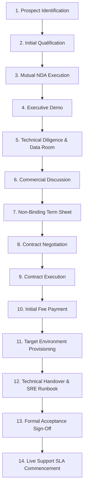

# SpiceGarden v1.0.0-rc1 — Commercial Licensee Qualification & Sales Funnel Process

**Document Name:** Licensee Qualification & Commercial Engagement Workflow  
**Version:** `1.0.0`  
**Date:** 2026-09-30  
**Status:** `INTERNAL REVIEW / SALES PLAYBOOK`  
**Owner:** Commercialization Lead  
**Document Classification:** `INTERNAL SALES & GOVERNANCE PROCEDURE`  

---

## 1. Overview of 14-Stage Commercial Qualification Funnel

---

## 2. Stage-by-Stage Checklists and Gate Criteria

### Stage 1: Prospect Identification
- [ ] Research target enterprise food delivery operators, regional restaurant groups, and quick-commerce startups.
- [ ] Confirm geographic alignment with target licensing territories.
- [ ] Identify key economic buyer (CTO, CEO, Head of Product).

### Stage 2: Initial Qualification (BANT Criteria)
- [ ] **Budget:** Confirm budget range matches indicative licence fees (₹75L – ₹2Cr+).
- [ ] **Authority:** Direct engagement with decision-making executive.
- [ ] **Need:** Verified requirement to replace legacy tech or launch proprietary food delivery platform.
- [ ] **Timeline:** Planned deployment launch within 3 to 6 months.

### Stage 3: Mutual NDA Execution
- [ ] Send [`final/SPICEGARDEN_MUTUAL_NDA_DRAFT.md`](file:///c:/Users/mehta/Desktop/SpiceGarden/final/SPICEGARDEN_MUTUAL_NDA_DRAFT.md).
- [ ] Resolve any counterparty redlines with legal counsel.
- [ ] Bilateral execution of NDA logged in legal register.

### Stage 4: Executive Product Demonstration
- [ ] Conduct live walkthrough of Customer Web, Mobile Apps, Restaurant KDS, Driver Partner App, and Super Admin dashboard.
- [ ] Demonstrate real-time order lifecycle and dispatch algorithms.
- [ ] Present high-level architecture and 20k VU load qualification summary.

### Stage 5: Technical Due Diligence & Data Room Access
- [ ] Grant Stage 2 / Stage 3 Diligence Data Room access.
- [ ] Provide test evidence reports, SBOMs, DR drill logs, and security test summaries.
- [ ] Host technical Q&A session between Licensor and Licensee engineering leadership.

### Stage 6: Commercial Structuring & Scoping
- [ ] Determine appropriate commercial licence tier (Tier A, Tier B, or Tier C).
- [ ] Scope implementation requirements, customizations, data migration, and training needs.
- [ ] Present formal Commercial Proposal ([`final/SPICEGARDEN_ENTERPRISE_LICENCE_PROPOSAL.md`](file:///c:/Users/mehta/Desktop/SpiceGarden/final/SPICEGARDEN_ENTERPRISE_LICENCE_PROPOSAL.md)).

### Stage 7: Non-Binding Term Sheet
- [ ] Draft and execute commercial term sheet outlining licence fee, payment schedule, exclusivity terms, and timeline.
- [ ] Secure executive sponsorship and sign-off on commercial framework.

### Stage 8: Definitive Contract Negotiation
- [ ] Deliver Master Software Licence Agreement ([`final/SpiceGarden_Master_Software_Licence_Agreement_v1.0.md`](file:///c:/Users/mehta/Desktop/SpiceGarden/final/SpiceGarden_Master_Software_Licence_Agreement_v1.0.md)) with Schedules A through F.
- [ ] Review legal comments with Indian corporate counsel.
- [ ] Finalize custom clauses, Territory boundaries, and SLA parameters.

### Stage 9: Contract Execution
- [ ] Final review of clean execution copies.
- [ ] Authorized signatories execute Master Software Licence Agreement and Order Form.

### Stage 10: Initial Payment & Invoicing
- [ ] Issue formal GST tax invoice for upfront licence and implementation fee.
- [ ] Confirm receipt of initial fee payment (e.g., 50% on signing, 50% on acceptance).

### Stage 11: Target Environment Provisioning
- [ ] Verify Licensee cloud Kubernetes cluster (EKS/GKE/AKS), PostgreSQL 16 HA, and Redis 7.2 instances.
- [ ] Configure network ingress, TLS certificates, and domain names.
- [ ] Deploy container images and apply database migration scripts.

### Stage 12: Technical Handover & SRE Runbook
- [ ] Execute 20 hours of structured technical training for Licensee engineering team.
- [ ] Deliver operational runbooks, Prometheus alert templates, and backup automation scripts.
- [ ] Support Licensee in binding live Stripe/Razorpay keys and mobile app signing keys.

### Stage 13: Formal Acceptance Testing & Sign-Off
- [ ] Execute 14-day formal acceptance test protocol against Schedule F criteria.
- [ ] Execute bilateral Certificate of Acceptance.

### Stage 14: Support & SLA Commencement
- [ ] Activate Licensee Jira Service Management support accounts.
- [ ] Initiate P1-P4 SLA coverage and recurring maintenance schedule.
