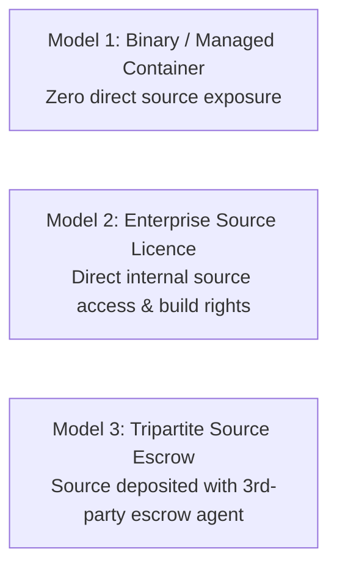

# SpiceGarden v1.0.0-rc1 — Source-Code Access & Escrow Policy

**Document Name:** Source-Code Access and Escrow Policy (Schedule C)  
**Version:** `1.0.0`  
**Date:** 2026-09-30  
**Status:** `INTERNAL REVIEW`  
**Owner:** Commercialization & IP Lead  
**Document Classification:** `POLICY AND LICENSING FRAMEWORK`  

---

## 1. Overview of Source-Code Governance Models

SpiceGarden structures source-code access into three distinct commercial models to balance licensee operational security with licensor intellectual property protection:

---

## 2. Detailed Access Models

### Model 1: Hosted / Binary & Container Deployment (Standard Tier A)
* **Delivery:** Pre-built Docker container images, Next.js standalone bundles, compiled NestJS binaries, and mobile distribution packages (AAB/IPA).
* **Source Access:** **None.** Licensee receives compiled artifacts and configuration manifests.
* **Permitted Uses:** Running containers, modifying environment configuration variables, executing database migrations, utilizing public REST/WebSocket APIs.
* **Prohibited Uses:** Reverse engineering, decompiling, disassembling, or attempting to derive original source code.

---

### Model 2: Enterprise Source-Code Licence (Strategic Tier B/C)
* **Delivery:** Full Git repository monorepo access across all 12 workspaces, including source TypeScript, SQL, Dockerfiles, and CI/CD pipelines.
* **Source Access:** Internal read/write or read-only access granted via secure private repository permissions.
* **Permitted Uses:** Internal security audits, vulnerability scanning, custom internal integrations, bug patching, creating internal derivative works strictly for licensee's own operations.
* **Prohibited Uses:** Sublicensing, distributing, selling, open-sourcing, or sharing source code with third parties or competitors. Zero external redistribution rights.

---

### Model 3: Source-Code Escrow (Risk-Mitigated Enterprise Deployment)
* **Delivery:** Source code is deposited with an established independent third-party escrow agent (e.g., NCC Group / Iron Mountain / Escrow London).
* **Operation:** Licensor maintains regular deposits; Licensee is named as a registered beneficiary.

---

## 3. Tripartite Source-Code Escrow Operational Specifications

### A. Deposit Contents
Every escrow deposit package must contain:
1. Complete uncompiled source tree of all 12 monorepo workspaces for `v1.0.0-rc1` (commit `ca349e510d3c18a7517da7502f70ef15bd37fe77`).
2. Build instructions, Dockerfiles, package lockfiles, and environment template specifications.
3. Database migration scripts and seed datasets.
4. Cryptographic SHA-256 hash manifest (`ARTIFACT_HASHES.sha256`).

### B. Escrow Agent & Verification
* **Escrow Agent:** A reputable, neutral escrow technology provider mutually agreed upon in the Order Form.
* **Verification Level:** Level 2 Usability / Build Verification (escrow agent performs clean environment compilation from source to confirm runnable container artifacts).

### C. Release Triggers (Strictly Defined)
Escrow materials shall be released to Licensee ONLY upon the occurrence of one of the following verified events:
1. **Insolvency / Cessation Event:** Licensor files for bankruptcy, enters liquidation, assigns assets for the benefit of creditors, or ceases normal commercial operations without a successor entity.
2. **Support Abandonment:** Licensor permanently discontinues support services and fails to cure such abandonment within sixty (60) days of receiving formal written notice from Licensee.
3. **Material Breach of Support Agreement:** An arbitral tribunal or court of competent jurisdiction issues a final, non-appealable determination that Licensor has materially breached its core support obligations and failed to cure within the statutory period.

### D. Dispute & Release Procedure
1. Licensee submits a formal sworn claim of Release Event to the Escrow Agent.
2. Escrow Agent notifies Licensor within 5 business days.
3. Licensor has thirty (30) days to dispute the claim. If undisputed, Escrow Agent releases the deposit package. If disputed, release is frozen pending expedited arbitration under Clause 40.

### E. Post-Release Rights and Restrictions
* Upon a valid release from escrow:
  - Licensee receives a non-exclusive, internal-use-only licence to compile, maintain, and patch the source code solely to support its ongoing internal operations.
  - Licensee acquires **NO ownership or copyright title** in the source code.
  - Licensee shall NOT sell, publish, commercialize, or sublicense the source code to any third party.
  - Confidentiality obligations survive perpetually.
