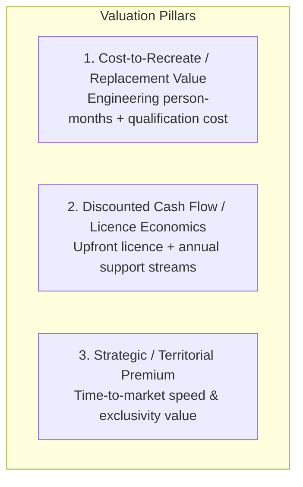

# SpiceGarden v1.0.0-rc1 — Commercial Software Asset Valuation Framework

**Document Name:** Commercial Software Asset Valuation Framework  
**Version:** `1.0.0`  
**Date:** 2026-09-30  
**Status:** `INTERNAL REVIEW`  
**Owner:** Commercialization & Finance Lead  
**Document Classification:** `INDICATIVE VALUATION METHODOLOGY — NOT AN APPRAISAL OR GUARANTEE`  

> [!NOTE]
> This framework provides objective, scenario-based financial and asset valuation methodologies for the SpiceGarden software platform. It separates intrinsic engineering replacement cost from commercial licensing economics. It does NOT assert a guaranteed market valuation or apply public SaaS revenue multiples inappropriately.

---

## 1. Valuation Methodologies Applied

### A. Cost-to-Recreate (Engineering Replacement Basis)
* **Scope:** 12 monorepo workspaces (NestJS API, 6 frontends, 5 shared packages, K8s manifests, automated tests).
* **Effort Estimate:** Approximately 36–48 engineering person-months of specialized full-stack, mobile, SRE, and QA engineering.
* **Estimated Replacement Cost:** **₹1.20 Crore – ₹1.80 Crore (INR 12M – 18M / ~$145k – $215k)** at prevailing senior Indian engineering rates.

---

## 2. Scenario-Based Commercial Valuation Matrix

| Valuation Scenario | Asset & Commercial Stage Description | Valuation Methodology | Indicative Estimated Valuation Range (INR) | Indicative Estimated Valuation Range (USD) |
| :--- | :--- | :--- | :--- | :--- |
| **Scenario A: Qualified Asset (No Commercial Customer)** | Software technically qualified (12 workspaces, 1,122 tests, 20k VU qualified, 0 copyleft), clean IP chain of title, zero active paying licensees. | Depreciated Replacement Cost + IP Documentation Premium. | **₹1.00 Crore – ₹1.50 Crore** | ~$120,000 – $180,000 |
| **Scenario B: Executed Single Enterprise Licence** | Software platform with 1 executed Tier A or Tier B commercial licence agreement and initial fee captured. | Asset Value + Contracted Initial Licence Cash Flow. | **₹1.75 Crore – ₹2.50 Crore** | ~$210,000 – $300,000 |
| **Scenario C: Active Licence + Annual Support Stream** | 1 enterprise licensee actively operating in production with verified annual support & maintenance contract (e.g., ₹15L–₹25L/yr). | 3-Year DCF of Contracted Maintenance + Core Asset Base. | **₹2.50 Crore – ₹3.75 Crore** | ~$300,000 – $450,000 |
| **Scenario D: Multi-Licensee Network / Recurring Scale** | 3 to 5 non-exclusive regional licensees generating ₹50L–₹1Cr/yr in aggregate recurring support and transaction fees. | Capitalized Recurring Cash Flow Multiplier (3.0x–5.0x ARR) + Platform Asset Base. | **₹4.50 Crore – ₹7.00 Crore+** | ~$540,000 – $840,000+ |

---

## 3. Separation of Value Components

To prevent blended or speculative calculations, enterprise value is decomposed into discrete components:

1. **Core Software Asset Base (Code & Architecture):** The unencumbered code, tested algorithms, DB schemas, and CI/CD pipelines.
2. **Upfront Licence Economics:** Contracted initial fees for deployment rights in designated territories.
3. **Recurring Support & Maintenance Revenue:** High-margin annual recurring maintenance contracts (SLA support, patch releases).
4. **Implementation & Professional Services:** Margin derived from onboarding, legacy data migration, and custom integrations.
5. **Exclusivity & Territorial Premiums:** Additional fees captured when granting geographic or industry vertical exclusivity.
6. **Source-Code Rights Premium:** Capitalization of source-access and derivative-work rights granted under Tier B/C.
