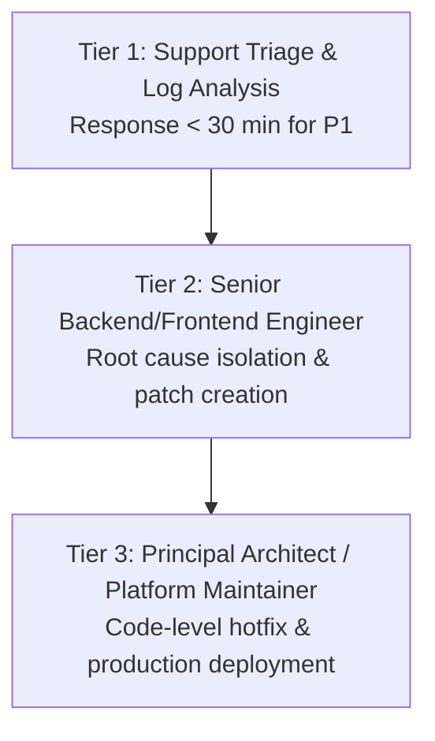

# SpiceGarden v1.0.0-rc1 — Technical Support & Service Level Agreement (SLA)

**Document Name:** Technical Support and Service Level Agreement (Schedule D)  
**Version:** `1.0.0`  
**Date:** 2026-09-30  
**Status:** `INTERNAL REVIEW`  
**Owner:** SRE & Customer Support Lead  
**Document Classification:** `INDICATIVE SLA FRAMEWORK — CONTRACT SCHEDULE`  

---

## 1. Incident Severity Definitions & Service Levels

Licensor categorizes all reported incidents into four priority levels:

| Priority Level | Severity Definition | Business Impact | Initial Response Target | Target Workaround / Restoration | Resolution Update Frequency |
| :--- | :--- | :--- | :--- | :--- | :--- |
| **P1 — Critical** | Complete platform outage, backend API failure, core payment processing failure, or severe data corruption impacting >50% of active users. | **Catastrophic** | **< 30 Minutes** (24/7/365) | **< 4 Hours** | Every 60 Minutes |
| **P2 — Major** | Major platform feature impaired (e.g., driver dispatch degraded, customer web search unavailable, restaurant KDS delayed) with no immediate workaround. | **High** | **< 2 Hours** (Standard Support Hours) | **< 12 Hours** | Every 4 Hours |
| **P3 — Moderate** | Non-critical feature impaired (e.g., driver earnings export delayed, minor UI layout bug on admin portal) with viable workaround available. | **Medium** | **< 8 Hours** (Business Hours) | **< 3 Business Days** | Daily |
| **P4 — Minor / Inquiry** | Cosmetic defects, minor documentation inquiries, general feature requests, or non-impacting configuration questions. | **Low** | **< 24 Hours** (Business Hours) | Next Scheduled Maintenance Release | Weekly / As Needed |

---

## 2. Support Hours & Channels

* **Standard Support Hours:** Monday through Friday, 09:00 to 18:00 IST (Indian Standard Time), excluding public holidays.
* **Mission-Critical Coverage (P1 Only):** 24 hours / day, 7 days / week, 365 days / year via automated emergency pager and dedicated hotline bridge.
* **Authorized Channels:**
  1. Ticket Portal: `support.spicegarden.io` (Dedicated Licensee Jira Service Management).
  2. Emergency P1 Bridge: `+91-XXXXXXXXXX` / Dedicated PagerDuty escalation webhook.
  3. Escalation Email: `support-escalations@spicegarden.io`.

---

## 3. Escalation Tiers & Matrix

* **Escalation Trigger:** If a P1 incident is not restored within 2 hours of report, automatic escalation to the Principal Architect and Executive Sponsor is initiated.

---

## 4. Maintenance Windows & Downtime Policies

### A. Planned Maintenance
* **Window:** Tuesdays and Thursdays between 02:00 AM and 05:00 AM IST (off-peak delivery hours).
* **Advance Notice:** Minimum **5 business days' advance written notice** provided via support portal and status email.
* **Monthly Downtime Cap:** Planned downtime shall not exceed 4 hours in any calendar month.

### B. Emergency Security Maintenance
* **Definition:** Critical zero-day vulnerability patching or critical infrastructure hardware remediation required to protect data integrity.
* **Advance Notice:** Minimum 2 hours' notice where practicable; immediate notification upon commencement if emergency action is required.

---

## 5. Security Incident Notification

* **Breach Notification:** Licensor shall notify Licensee in writing within **24 hours** of becoming aware of any confirmed security compromise in the core software codebase.
* **Vulnerability Disclosure:** Security patches for Common Vulnerabilities and Exposures (CVEs) scored High (CVSS >= 7.0) or Critical (CVSS >= 9.0) will be released within **72 hours** of triage.

---

## 6. Version Support & Deprecation Policy

* **N-1 Support Policy:** Licensor actively supports the current minor version (e.g., `v1.0.x`) and the immediately preceding minor version.
* **Minimum Support Lifetime:** Each major release receives active maintenance patches for a minimum of 18 months from official release date.

---

## 7. Exclusions & Limitations

The SLA commitments do NOT apply to service disruptions caused by:
1. **Licensee-Caused Incidents:** Operator misconfiguration, unauthorized database modifications, or failure to apply mandatory security updates.
2. **Third-Party Provider Outages:** Failures in external cloud infrastructure (e.g., AWS EC2/EKS outage), third-party payment gateways (e.g., Stripe/Razorpay network downtime), or mapping APIs (e.g., Google Maps API quota exhaustion).
3. **Modified Source Code:** Any software component altered or patched by Licensee without Licensor's written authorization.
4. **Force Majeure:** Acts of God, government internet shutdowns, or global telecommunication backbone cuts.
