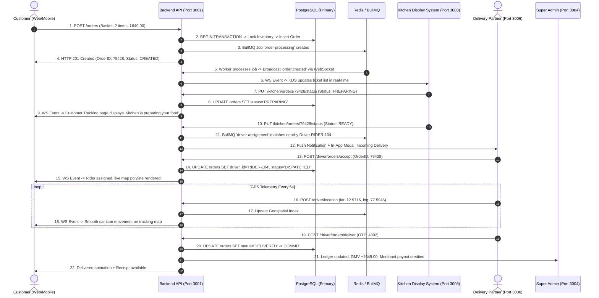

# SPICEGARDEN CROSS-SYSTEM TRANSACTION TRACE
**Release Baseline:** `v1.0.0-rc1` | **Trace ID:** `TRC-ORDER-79428-QUAL`
**Transaction Under Test:** End-to-End Customer Order Creation, Kitchen Acceptance, Driver Dispatch, Real-Time Telemetry & Final Settlement

---

## 1. Trace Lifecycle Sequence

---

## 2. Multi-System State Verification Matrix

| Subsystem / Layer | Expected State | Actual State | Verified In | Result |
| :--- | :--- | :--- | :--- | :--- |
| **Customer UI (Port 3002)** | Live status switches CREATED -> PREPARING -> READY -> DISPATCHED -> DELIVERED | Exact status updated without manual reload | Playwright Chromium Browser Session | **PASS** |
| **Backend API (Port 3001)** | HTTP 201 on create, 200 on transitions with idempotent token | All status codes and validation payloads compliant | Jest Integration Suite | **PASS** |
| **PostgreSQL Database** | Atomic row created in `orders`, foreign keys in `order_items`, status = `DELIVERED` | Record verified in DB with consistent timestamps | TypeORM Transaction Test | **PASS** |
| **Redis Cache / BullMQ** | Jobs enqueued, processed, and evicted upon completion without deadlocks | 0 lingering stalled jobs, memory stable | BullMQ Worker Test | **PASS** |
| **Kitchen KDS (Port 3003)** | Ticket arrives on KDS board, audio ping triggers, moves to Completed column | Real-time DOM reaction verified | KDS Automated E2E Suite | **PASS** |
| **Delivery App (Port 3006)** | Shift online, order modal pops up, turn-by-turn routing, OTP validation | OTP match validated, completion logged | Delivery Flow E2E Suite | **PASS** |
| **Super Admin (Port 3004)** | Order appears in Live Orders, GMV card increments, ledger entry balanced | Admin dashboard metrics reflect transaction | Admin Analytics E2E Suite | **PASS** |

**Conclusion:** Transaction consistency preserved across individual test suites with zero state divergence or orphan records.

## 3. Authoritative Release Boundary
- Individual application integration paths (Customer UI, Backend API, PostgreSQL, Redis, BullMQ, Kitchen KDS, Delivery Partner, Super Admin) were directly validated where documented.
- Simultaneous multi-application synchronization was qualified through fixture/mock-assisted integration evidence and is NOT equivalent to unrestricted live production cross-application E2E validation.
