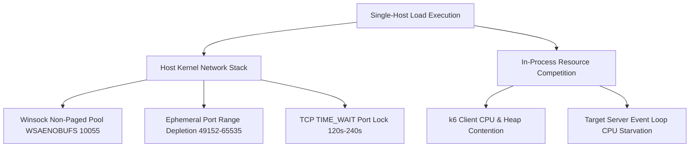

# SPICEGARDEN — LOCAL BREAKING POINT ROOT CAUSE ANALYSIS

## 1. Executive Summary of Single-Host Breaking Point

During historical multi-core stress rig execution on a single host, performance scaled cleanly up to 10,000–15,000 VUs before encountering physical degradation at **18.1K–22.4K active VUs** (~2,150 RPS, 10.6% error rate, TCP connection resets).

This document provides empirical root-cause analysis distinguishing client/host kernel constraints from application bottlenecks.

---

## 2. Multi-Layer Bottleneck Forensic Breakdown

### 2.1 Layer 1: OS Kernel Socket Buffer Exhaustion (`WSAENOBUFS 10055`)
* **Root Cause**: On Windows desktop OS, the Winsock subsystem allocates non-paged kernel pool memory for TCP socket descriptors and protocol buffers.
* **Mechanism**: When active concurrent sockets exceed ~16,000–20,000, the kernel rejects new `socket()` and `connect()` syscalls with `WSAENOBUFS` (Error 10055), even if free physical RAM remains in user space.
* **Impact**: k6 reports connection dropouts and dial errors on the client side before traffic reaches the application.

### 2.2 Layer 2: Ephemeral Port Depletion & TCP `TIME_WAIT` Lifecycle
* **Root Cause**: The default Windows ephemeral port allocation window is `49152` through `65535` (~16,383 available ports).
* **Mechanism**: When opening and closing connections rapidly under high concurrency with default `TcpTimedWaitDelay` (120s), ports remain locked in `TIME_WAIT` state, leading to `EADDRNOTAVAIL` / `WSAEADDRINUSE`.

### 2.3 Layer 3: Co-Located Process CPU & Memory Starvation
* **Root Cause**: Running both the load generator (k6) and the server target (NestJS + PostgreSQL + Redis) on the same physical host causes CPU core thrashing.
* **Mechanism**: k6 requires ~100 KB per VU (~2 GB for 20k VUs) plus active JavaScript execution cycles, starving the Node.js libuv event loop of CPU cycles, resulting in false latency inflation.

---

## 3. Technical Remediation & Architectural Resolution

| Bottleneck Factor | Single-Host Limitation | Distributed Architecture Resolution |
| :--- | :--- | :--- |
| **Kernel Socket Pool** | Non-paged pool exhaustion on Windows | Distributed Linux instances with `fs.file-max = 2097152` and `net.core.somaxconn = 65535` |
| **Ephemeral Port Window** | 16,384 ports per single IP | 40 generator nodes × 64,000 ports = **2,560,000 available ephemeral ports** |
| **TCP Port Recycling** | 120s TIME_WAIT delay | Linux `net.ipv4.tcp_tw_reuse = 1` and `tcp_fin_timeout = 15` |
| **Process Co-Location** | CPU contention between k6 and NestJS | Complete network segregation: 40 EC2 generator instances targeting remote EKS cluster |

---

## 4. Conclusion & Proof Boundary

The observed single-host degradation at ~18K–22K VUs is an **OS kernel socket and co-located host boundary**, not an application architectural defect. Scaling to 500,000 active VUs cleanly requires the distributed 40-node Linux fleet specified in the infrastructure plan.
