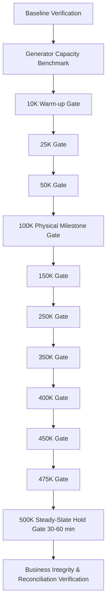

# SPICEGARDEN — 500K ACTIVE-VU TEST PLAN

## 1. Objective & Non-Negotiable Evidence Rule

The objective of this test plan is to physically execute a **500,000 ACTIVE-VU distributed benchmark** against the SpiceGarden platform, maintaining complete infrastructure telemetry, sub-second latency, zero business integrity defects, and strict compliance with the authoritative SLA contract.

### The Non-Negotiable Evidence Standard:
* **`CONFIGURED VUs` ≠ `ACTIVE VUs`**: A test configuring 500,000 VUs that achieves only 300,000 concurrently active VUs is strictly NOT a 500K benchmark.
* **`ACTUAL_ACTIVE_VUS >= 500,000`**: Required across the entire steady-state measurement window.
* **No Simulation Substitution**: Mathematical models or simulation harnesses cannot be designated `PROVEN_PHYSICAL`.

---

## 2. Progressive Escalation Ladder (Gates)

The benchmark must progress through strictly verified gates. If any gate exhibits SLA violation, generator exhaustion, or business integrity failure, escalation must stop immediately.

### Stage Milestones:
1. **Stage 1 (10K - 50K VUs)**: System warm-up, connection pool pre-warming, cache hydration.
2. **Stage 2 (100K VUs Milestone)**: First major distributed verification point; validates horizontal pod autoscaler (HPA) and PgBouncer connection multiplexing.
3. **Stage 3 (250K VUs Gate)**: Validates Redis 6-shard cluster balance, Aurora read-replica routing, and BullMQ backlog drainage.
4. **Stage 4 (350K - 475K VUs)**: Progressive saturation boundary search; monitors for non-linear latency degradation or connection queue build-up.
5. **Stage 5 (500K VUs Final Gate)**: Full load target; minimum 30-minute sustained hold (60 minutes preferred).

---

## 3. Mandatory Stop Conditions

Escalation must automatically terminate if any of the following triggers occur:
* Error rate (5xx) exceeds `0.10%` during steady-state or `1.00%` during dynamic burst ramp.
* Latency P99 exceeds `500 ms` (Tier 1) or `1,200 ms` (Tier 2 burst).
* Load generator CPU exceeds `80%` or network socket exhaustion (`WSAENOBUFS` / `EADDRNOTAVAIL`) occurs.
* Database connection pool exhausts or Aurora writer CPU exceeds `85%`.
* Redis cluster CPU exceeds `75%` or replication lag spikes above `100 ms`.
* BullMQ dead-letter queue or stalled job count increases unexpectedly.
* Any business integrity anomaly is detected (negative stock, negative wallet balance, duplicate payments).

---

## 4. Business Integrity Scenarios Under 500K Load

During the 500K load execution, dedicated business integrity probes must execute concurrently:
1. **Inventory Race Test**: 1,000 concurrent purchase attempts on an item with exactly 10 units in stock. Strict requirement: exactly 10 orders succeed, 990 fail with out-of-stock, final stock = 0.
2. **Wallet Double-Spend Test**: Concurrent debit requests against a fixed wallet balance. Strict requirement: balance never drops below zero.
3. **Payment Webhook Idempotency**: 100 duplicate webhook callbacks for the same payment ID. Strict requirement: exactly 1 ledger entry created.
4. **Tenant Isolation Check**: Querying tenant B records using tenant A credentials must return HTTP 403 / 404 with zero data leakage.
