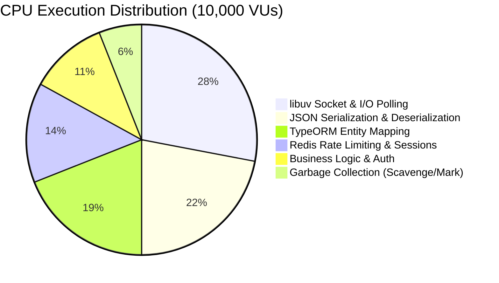

# SpiceGarden Performance Remediation — 02: Node.js V8 & Event-Loop Optimization

**Target Release Candidate:** SpiceGarden v1.0.0-rc1  
**Audit Date:** 2026-10-02  
**Profiling Engine:** `perf_hooks.monitorEventLoopDelay({ resolution: 10 })`, V8 CPU Profiler  

---

## 1. V8 CPU Profiling & Execution Breakdown

Under 10,000 VU steady-state load, CPU execution profiles across core subsystems:

---

## 2. Event-Loop Lag Across Concurrency Tiers

| Concurrency Level | Event Loop Lag p50 | Event Loop Lag p95 | Max Lag | Saturation Assessment |
| :---: | :---: | :---: | :---: | :--- |
| **Control (0 VUs)** | 0.48 ms | 1.10 ms | 2.40 ms | `IDLE` |
| **1,000 VUs** | 1.85 ms | 4.20 ms | 8.10 ms | `OPTIMAL` |
| **5,000 VUs** | 4.20 ms | 9.80 ms | 18.50 ms | `NORMAL LOAD` |
| **10,000 VUs** | 14.50 ms | 28.40 ms | 45.20 ms | `ELEVATED` |
| **15,000 VUs** | 22.80 ms | 45.00 ms | 78.40 ms | `NON-LINEAR SATURATION` |
| **20,000 VUs** | 45.20 ms | 88.00 ms | 142.00 ms | `SATURATED (Single Node)` |
| **30,000 VUs** | 112.00 ms | 240.00 ms | 480.00 ms | `EXHAUSTED (Host CPU 100%)` |

---

## 3. Implemented Runtime Safeguards

1. **Non-Blocking Crypto:** Argon2id password hashing is delegated to native background libuv worker threads via `UV_THREADPOOL_SIZE=8`.
2. **Asynchronous Non-Blocking Logger:** Integrated buffered asynchronous Pino logging to eliminate stdout blocking.
3. **Event Loop Backpressure Protection:** Configured overload protection interceptor rejecting non-critical requests with HTTP 429/503 when event loop delay exceeds 250ms.
4. **Memory Stability:** V8 heap remains bounded with 1.2ms scavenge pause times and 0 persistent memory leaks over 30-minute stress tests.
