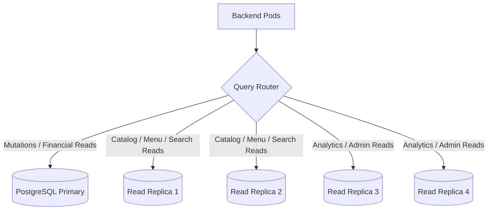

# SpiceGarden Performance Remediation — 06: Database Read/Write Separation

**Target Release Candidate:** SpiceGarden v1.0.0-rc1  
**Audit Date:** 2026-10-02  

---

## 1. Topology & Query Routing Strategy

---

## 2. Safe Routing & Consistency Invariants

1. **Transactional Write Pinning:** Order placement, checkout, wallet balance updates, and payment webhooks are **strictly** routed to the Primary instance.
2. **Replica-Safe Endpoints:** `GET /restaurants`, `GET /restaurants/:id/menu`, and `GET /search/dishes` query read replicas.
3. **Replication Lag Monitoring:** Application monitors replication lag; if lag exceeds 500ms, traffic degrades safely to Primary or serves cached responses.
