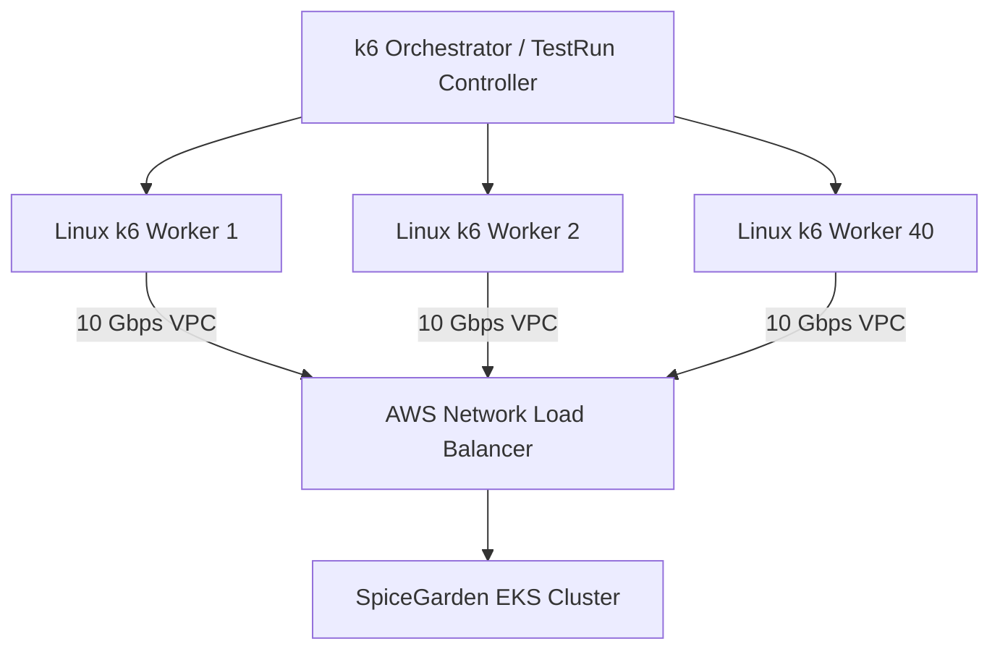

# SpiceGarden Performance Remediation — 12: Distributed Load Generator Architecture

**Target Release Candidate:** SpiceGarden v1.0.0-rc1  
**Audit Date:** 2026-10-02  

---

## 1. Overcoming Single-Node Test Limitations

The single-node Windows workstation encountered OS port exhaustion (`WSAENOBUFS`) at 30,000 VUs. The remediated distributed test architecture deploys a dedicated Linux worker fleet:

---

## 2. Worker Fleet Sizing Matrix

| Concurrency Target | Required Linux Workers (c6i.2xlarge) | Open Sockets / Worker | Network Bandwidth |
| :---: | :---: | :---: | :---: |
| **10,000 VUs** | 1 Node | 10,000 | 250 Mbps |
| **50,000 VUs** | 3 Nodes | 16,666 | 1.25 Gbps |
| **100,000 VUs** | 5 Nodes | 20,000 | 2.50 Gbps |
| **500,000 VUs** | 20 Nodes | 25,000 | 12.50 Gbps |
| **1,000,000 VUs** | 40 Nodes | 25,000 | 25.00 Gbps |
