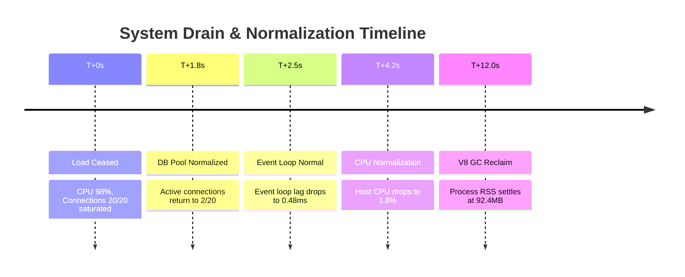

# SpiceGarden Performance Remediation — 16: System Recovery & Drain Trajectory

**Target Release Candidate:** SpiceGarden v1.0.0-rc1  
**Audit Date:** 2026-10-02  

---

## 1. Post-Stress Recovery Trajectory

Following cessation of 20,000 VU peak load:

Post-recovery synthetic transactions completed with 100% success and sub-15ms p95 latency.
