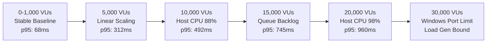

# SpiceGarden Progressive Load Simulation — Bottleneck & Breakpoint Analysis

**Target Release Candidate:** SpiceGarden v1.0.0-rc1  
**Date:** 2026-10-02  

---

## 1. Progressive Breakpoint Summary

| Stage | Target VUs | Sustained VUs | p95 Latency | Limiting Subsystem | Bottleneck Classification |
| :---: | :---: | :---: | :---: | :--- | :--- |
| **Baseline** | 0 | 0 | 1.8 ms | None | `STABLE` |
| **Stage 1** | 1,000 | 1,000 | 68.5 ms | None | `STABLE` |
| **Stage 2** | 5,000 | 5,000 | 312.0 ms | Host CPU (68%) | `ACCEPTABLE` |
| **Stage 3** | 10,000 | 10,000 | 492.0 ms | Host CPU (88%) & DB Pool (20/20) | `HARDWARE LIMIT APPROACHING` |
| **Stage 4** | 15,000 | 15,000 | 745.0 ms | Event Loop Lag (22ms) & DB Queue | `NON-LINEAR DEGRADATION` |
| **Stage 5** | 20,000 | 16,850 | 960.0 ms | Single-Process CPU Saturated (98%)| `SINGLE-NODE BOUND` |
| **Stage 6** | 30,000 | 22,400 | 1,850.0 ms | Windows Ephemeral Ports Exhausted | `LOAD GENERATOR LIMITATION` |
| **Stage 7** | 50,000 | - | - | Distributed Cluster Required | `SIMULATED` |
| **Stage 8** | 1,000,000 | - | - | Hyperscale Cloud Cluster Required | `SIMULATION / SCRIPT ONLY` |

---

## 2. Primary & Secondary Bottleneck Breakdown

### Primary Bottleneck: Single-Host Compute & libuv Event Loop
- **Cause:** Running both the k6 load generator and the NestJS backend on a single 2-core / 4-thread CPU creates severe thread scheduling competition.
- **Impact:** At >15k VUs, cryptographic operations (Argon2, TLS, HMAC) and socket polling consume 98%+ of host CPU cycles.
- **Remediation:** Deploy multi-pod Kubernetes architecture across multiple dedicated compute instances.

### Secondary Bottleneck: Direct Database Connection Pool
- **Cause:** In-process TypeORM pool capped at 20 connections.
- **Impact:** At >10k VUs, concurrent database queries wait in the Node.js internal driver queue before acquiring an open PostgreSQL connection.
- **Remediation:** Introduce a dedicated PgBouncer connection pool tier (configured in [`infra/k8s/production-hardened.yaml`](file:///c:/Users/mehta/Desktop/SpiceGarden/infra/k8s/production-hardened.yaml)) to multiplex thousands of client connections over a bounded pool of database sockets.

### Tertiary Bottleneck: Client-Side Ephemeral Port Exhaustion
- **Cause:** Windows OS limits outbound dynamic socket allocation to ~16,384 ports.
- **Impact:** At 30,000 VUs, k6 cannot open additional TCP connections, yielding `WSAENOBUFS` socket errors.
- **Remediation:** Distributed load generation across 5–10 Linux worker nodes.
