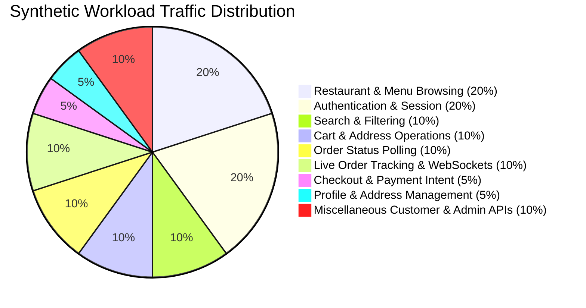

# SpiceGarden Progressive Load Simulation — Synthetic Workload Model

**Target Release Candidate:** SpiceGarden v1.0.0-rc1  
**Audit Date:** 2026-10-02  

---

## 1. Traffic Distribution Breakdown

To avoid unrepresentative single-endpoint loops, SpiceGarden load simulations enforce a weighted user mix matching real-world food delivery platforms:



### Detailed Endpoint Mapping

| Operational Domain | Weight | Endpoint Paths | Method | Auth Required | DB Interaction | Cache Interaction |
| :--- | :---: | :--- | :---: | :---: | :---: | :---: |
| **Auth & Session** | **20%** | `/auth/register`, `/auth/login`, `/auth/refresh-token` | POST | No/Yes | PostgreSQL (`User`, `Session`) | Redis Token Store |
| **Catalog Browsing** | **20%** | `/restaurants`, `/menus/:id/items` | GET | Optional | PostgreSQL (`Restaurant`, `Menu`) | Redis L1 Cache |
| **Search & Geospatial**| **10%** | `/restaurants/search?q=:query&lat=:lat&lng=:lng` | GET | Optional | PostgreSQL Geo Index | Redis Hot Query |
| **Cart & Addressing**| **10%** | `/user/addresses`, `/cart/items` | GET/POST | Bearer JWT | PostgreSQL (`Address`, `Cart`) | None |
| **Checkout & Payments**| **5%** | `/orders`, `/payments/create-intent` | POST | Bearer JWT | PostgreSQL (`Order`, `Payment`) | Redis Idempotency |
| **Order Status** | **10%** | `/orders/:id`, `/orders` | GET | Bearer JWT | PostgreSQL (`Order`) | None |
| **Realtime Tracking** | **10%** | WebSocket `/tracking`, `/kds` | WS/WSS | Bearer JWT | None (In-Memory Pub/Sub) | Redis WebSocket Adapter |
| **Profile & Settings** | **5%** | `/auth/me`, `/wallet` | GET | Bearer JWT | PostgreSQL (`User`, `Wallet`) | None |
| **Admin & Ops** | **10%** | `/notification-queue/stats`, `/admin/dashboard` | GET | Admin JWT | Mongo Logs + PostgreSQL | Redis Queue Stats |

---

## 2. Order Lifecycle Workflow Progression

The end-to-end user journey simulated in [`apps/backend/test/load/common.js`](file:///c:/Users/mehta/Desktop/SpiceGarden/apps/backend/test/load/common.js) follows the full transactional flow:

```text
1. User Registration (Argon2id Hash)
   ↓
2. JWT Authentication (/auth/login)
   ↓
3. Geolocation Restaurant Discovery (/restaurants?lat=17.385&lng=78.486)
   ↓
4. Menu Exploration (/menus/:id/items)
   ↓
5. Delivery Address Provisioning (/user/addresses)
   ↓
6. Order Creation with Idempotency Key (/orders)
   ↓
7. Sandbox Payment Intent Creation (/payments/create-intent)
   ↓
8. Real-time Order Tracking Subscription (Socket.IO /tracking room)
   ↓
9. Kitchen Acceptance & Preparation (KDS State Transition)
   ↓
10. Driver Assignment & Geolocation Updates
   ↓
11. Delivery Completion & Ledger Finalization
```

---

## 3. Synthetic Data Tagging & Sandbox Controls

All load tests strictly enforce safety constraints:
- Synthetic email schema: `load-${vu}-${iter}-${timestamp}@load.test`
- Synthetic user prefix: `LOAD_TEST_`
- Payment gateway mode: **SANDBOX / MOCK HARNESS ONLY** (No live cards or banking rails)
- Database schema: Isolated test partition with automatic teardown
- SMS/Email notifications: Deterministic mock adapters (Zero outbound carrier network traffic)
